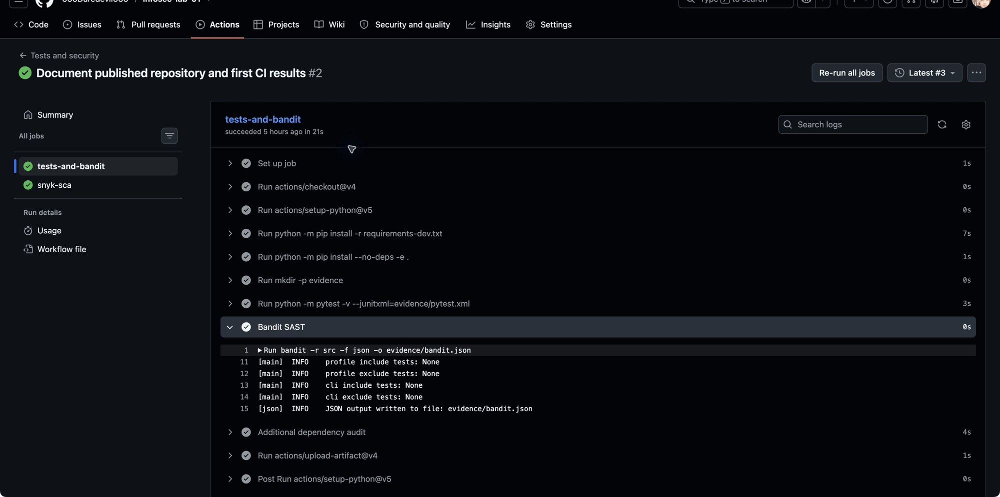
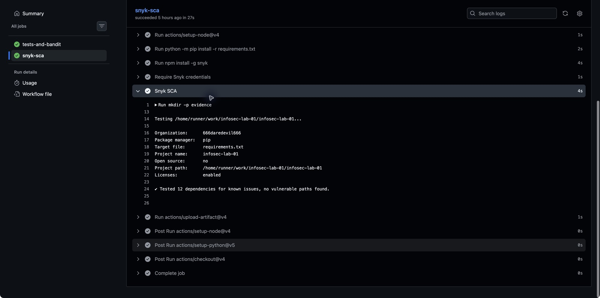

# Работа №1. Разработка защищенного REST API с интеграцией в CI/CD

Учебное приложение на Python 3.13, Flask, SQLite, Argon2id и JWT. Три маршрута позволяют создать пользователя, получить токен и прочитать данные после входа.

## Запуск

Из каталога `lab-01`:

```sh
python3 -m venv .venv
source .venv/bin/activate
python -m pip install -r requirements-dev.txt
python -m pip install --no-deps -e .
python scripts/run.py
```

Адрес: `http://127.0.0.1:8080`. Debug выключен. `run.py` генерирует случайный ключ подписи в памяти; перезапуск делает старые токены недействительными. Для постоянного ключа можно заранее задать переменную окружения `JWT_SECRET` (не менее 32 байт). Не добавлять ключ в Git или отчёт. SQLite сохраняется в каталоге instance пакета; свой путь задаётся переменной `API_DATABASE`.

Сервер Flask используется для локальной демонстрации. Для публичного размещения нужны HTTPS, сервер WSGI, ограничение частоты запросов и эксплуатационные настройки; такое размещение в лабораторной не выполнялось.

## API

| Метод | Путь | Назначение |
|---|---|---|
| POST | /auth/register | Регистрация, ответ 201; повтор логина 409 |
| POST | /auth/login | Проверка пароля, выдача JWT; неверные данные 401 |
| GET | /api/data | Данные текущего пользователя; без корректного JWT 401 |

Оба POST принимают JSON с двумя строками `login` и `password`. Логин: 1–80 символов, без внешних пробелов и управляющих символов. Пароль: 12–128 символов. Тело запроса ограничено 16 KiB. Ошибочные запросы возвращают JSON и соответствующий HTTP-код.

Пример регистрации с вымышленными учебными данными:

```sh
curl -i http://127.0.0.1:8080/auth/register \
  -H 'Content-Type: application/json' \
  --data '{"login":"student","password":"Demo-password-2026!"}'
```

Получение токена и чтение данных:

```sh
TOKEN=$(curl -fsS http://127.0.0.1:8080/auth/login \
  -H 'Content-Type: application/json' \
  --data '{"login":"student","password":"Demo-password-2026!"}' \
  | python -c 'import json,sys; print(json.load(sys.stdin)["access_token"])')
curl -i http://127.0.0.1:8080/api/data \
  -H "Authorization: Bearer $TOKEN"
unset TOKEN
```

Проверка отказа без токена:

```sh
curl -i http://127.0.0.1:8080/api/data
```

Ожидается 401. Неверный пароль при входе также даёт 401. JWT содержит `sub`, `iat`, `exp`, `iss`, `aud`; время жизни 900 секунд. Ответ входа: `access_token`, `token_type`, `expires_in`. Токен не включать в публичные скриншоты и логи.

## Меры защиты

- SQLi: все запросы с пользовательскими значениями используют параметры SQLite `?`. Ввод не становится частью структуры SQL.
- XSS: исходный логин хранится без изменения, перед выдачей экранируется `markupsafe.escape`. Ответы имеют Content-Type application/json и X-Content-Type-Options nosniff. CSP запрещает загрузку содержимого и встраивание страницы. Клиент также должен безопасно выводить данные, например через textContent.
- Пароли: Argon2id со случайной солью и параметрами библиотеки argon2-cffi. В БД хранится только хэш. При входе используется verify, при изменении рекомендуемых параметров выполняется rehash. Пароли не возвращаются клиенту.
- JWT: HS256 с ключом из окружения либо случайным ключом локального процесса. Сервер проверяет подпись, допустимый алгоритм, срок, issuer, audience и обязательные claims. Middleware проверяет существование пользователя. Неподписанные JWT и токены с другим ключом отклоняются.
- Ошибки и данные: проверяются JSON, типы, набор полей, длины; ошибки HTTP возвращаются в JSON. Cache-Control no-store уменьшает риск кэширования ответов. Одинаковая ошибка входа для неизвестного логина и неверного пароля; проверка dummy-хэша для отсутствующего пользователя уменьшает различие времени обработки.

## Проверки

```sh
mkdir -p evidence
python -m pytest -v --junitxml=evidence/pytest.xml
bandit -r src -f json -o evidence/bandit.json
pip-audit -r requirements.txt -f json -o evidence/pip-audit.json
python scripts/demo.py
```

`demo.py` сам запускает временный сервер на свободном порту 127.0.0.1, отправляет настоящие curl-запросы, проверяет HTTP-коды и завершает сервер. Его БД удаляется, токен скрывается в сохранённом журнале `evidence/curl-demo.txt`.

Тесты проверяют Argon2-хэш в SQLite, регистрацию и дубликат, вход и доступ, неверные учётные данные, отсутствие токена, неверную подпись, expiry, audience, отсутствие exp, алгоритм none, параметризацию SQL, экранирование вывода, сохранение исходного логина, неверные JSON/типы/длины и ограничение размера запроса.

Фактические результаты на 13.10.2026: 23 теста пройдены; pip-audit проверил 12 runtime-зависимостей и не нашёл известных уязвимостей; curl подтвердил ответы 401/201/409/401/200/200. Bandit: 0 находок после одного документированного исключения B106 для стандартного значения `token_type=Bearer` (это не пароль). Подробности в `evidence/VERIFICATION.md`. Эти результаты относятся к локальному запуску.

## GitHub Actions

Репозиторий: https://github.com/666Daredevil666/infosec-lab-01

Успешный запуск CI от 13.10.2026: https://github.com/666Daredevil666/infosec-lab-01/actions/runs/38417155612

На каждый push и pull_request запускаются pytest, Bandit (SAST), pip-audit и Snyk (SCA). Обе задачи завершились успешно. Snyk проверил 12 зависимостей; при пороге high уязвимых путей не найдено. Это не утверждение об отсутствии любых возможных уязвимостей.

Workflow: `.github/workflows/ci.yml`. Токен Snyk хранится в repository secret `SNYK_TOKEN`. Отсутствующий секрет приводит к ошибке проверки. JSON-отчёты сохраняются в Actions artifacts: `tests-and-local-security` и `snyk-sca-report`.

### Полный отчёт

В каждом новом запуске Actions создаётся артефакт `full-report`. Скачайте ZIP, распакуйте и откройте `index.html` в браузере. Интернет для просмотра не нужен.

В отчёте: все библиотеки приложения и установленные версии, прямые и транзитивные зависимости, назначение библиотек, полный состав Python-окружения CI (включая инструменты), метаданные лицензий и Requires-Dist, результаты Bandit, pip-audit, Snyk и каждого теста. Исходные JSON/XML встроены в HTML. Есть поиск по таблицам.

Snyk теперь выводит находки всех уровней серьёзности. SCA проверяет зависимости приложения из `requirements.txt`; служебные библиотеки приведены как инвентаризация, а не как отдельно проверенные зависимости. Если исходный отчёт отсутствует или повреждён, HTML явно указывает это. Неуспешные проверки сохраняют красный статус CI.

### Скриншоты SAST/SCA из GitHub Actions

Bandit: успешный шаг, JSON-отчёт записан в evidence/bandit.json.



Snyk: 12 проверенных зависимостей, уязвимых путей при заданном пороге не найдено.



Скриншоты показывают запуск 38417155612, commit 92fc9f5. Из исходных снимков обрезаны только панели браузера с личными закладками; содержимое результатов не изменялось.

Клонирование проекта:

```sh
git clone https://github.com/666Daredevil666/infosec-lab-01.git
cd infosec-lab-01
```

## Источники

- Flask: https://flask.palletsprojects.com/en/stable/testing/
- Argon2: https://argon2-cffi.readthedocs.io/en/stable/howto.html
- JWT: https://pyjwt.readthedocs.io/en/stable/usage.html
- GitHub Actions: https://docs.github.com/en/actions
- Snyk/Python: https://docs.snyk.io/supported-languages/supported-languages-list/python

Ответы для защиты: `ANSWERS.md`; исходные вопросы и требования сохранены в `REQUIREMENTS.md`.
